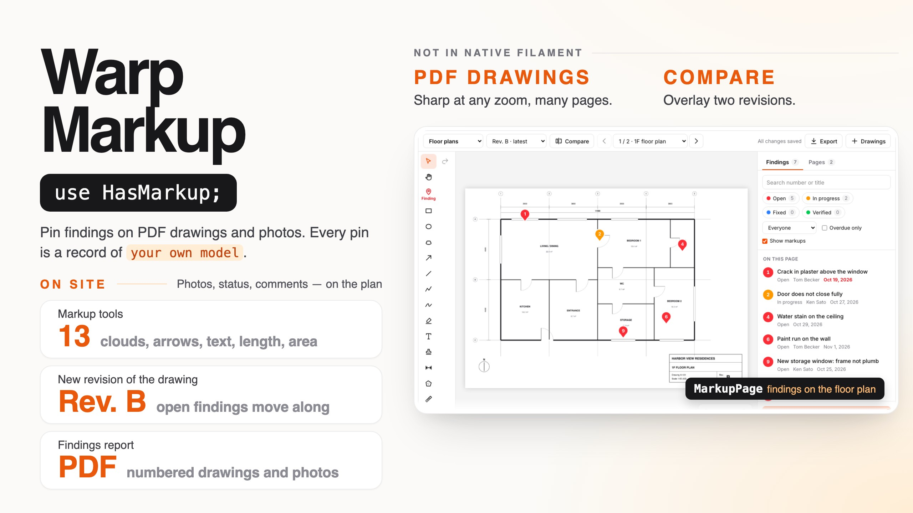
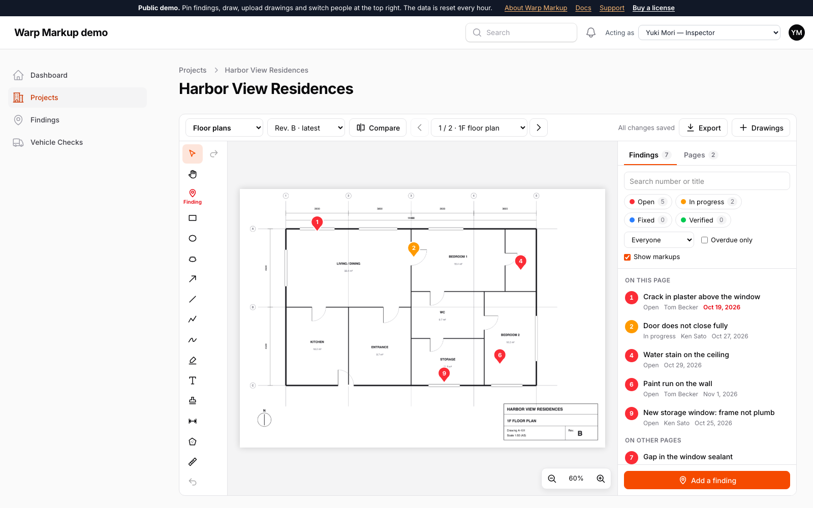

# Warp Markup

**Drawing and photo markup for Filament. Pin findings on PDF drawings and photos, sketch clouds, arrows, text and dimensions, and track every finding as a record of your own model — with status colors, assignees, due dates, photos from the site, comments, drawing revisions that carry open findings over, a revision compare (overlay or slider) and a findings report.**

<a href="https://demo.warpui.com/markup"></a>

Open a floor plan, drop a pin on a crack, attach a photo, mark it fixed, upload the next revision of the drawing and see the open findings move over — at **[demo.warpui.com/markup](https://demo.warpui.com/markup)**. No sign-up needed; the data is reset every hour.



- [What it does](#what-it-does)
- [Installation](#installation)
- [Quick start](#quick-start)
- [The workspace](#the-workspace)
- [Findings](#findings)
- [Statuses](#statuses)
- [Changing many findings at once](#changing-many-findings-at-once)
- [Rules for status changes](#rules-for-status-changes)
- [Drawings and revisions](#drawings-and-revisions)
- [Searching the text of a drawing](#searching-the-text-of-a-drawing)
- [Tools](#tools)
- [Layers](#layers)
- [Areas (rooms)](#areas-rooms)
- [Links between drawings](#links-between-drawings)
- [Measuring](#measuring)
- [Quantities](#quantities)
- [Stamps](#stamps)
- [Common issues (finding templates)](#common-issues-finding-templates)
- [Pin symbols (a pin list)](#pin-symbols-a-pin-list)
- [Checklists](#checklists)
- [Comments and photos](#comments-and-photos)
- [AI suggestions](#ai-suggestions)
- [Export and the findings report](#export-and-the-findings-report)
- [Summary](#summary)
- [Sign-off at handover](#sign-off-at-handover)
- [Share links for people without an account](#share-links-for-people-without-an-account)
- [Linking to a finding](#linking-to-a-finding)
- [Notifications and events](#notifications-and-events)
- [The daily digest](#the-daily-digest)
- [The form field](#the-form-field)
- [Who can do what](#who-can-do-what)
- [Multi-tenancy](#multi-tenancy)
- [Working together](#working-together)
- [On phones and tablets](#on-phones-and-tablets)
- [Using it from code](#using-it-from-code)
- [All options](#all-options)
- [Translations](#translations)
- [Requirements](#requirements)

## What it does

| | |
| --- | --- |
| **Findings are your records** | Each pin is a row of your own model (`Defect`, `Issue`, `PunchItem` …) with your own form. Your tables, filters, exports and policies keep working — the drawing is just another way to see them. |
| **PDF drawings, sharp at any zoom** | Upload multi-page PDFs or photos. PDF pages are drawn with pdf.js and re-drawn at the zoom you look at, so text on an A0 sheet stays crisp. |
| **Markup tools people know** | Pins, rectangles, ellipses, revision clouds, arrows, lines, polylines, pen, highlighter, text, stamps, length and area with a calibrated scale. Undo, copy and paste, keyboard shortcuts. |
| **Revisions** | Upload the next revision of a drawing: open findings (or everything) move to the new sheet, with their numbers. Compare two revisions as an overlay (removed in red, added in blue) or with a slider, line up shifted scans with two points, and let it draw revision clouds around everything that changed. |
| **Rooms, links and quantities** | Draw the rooms once: a finding placed in a room gets its name, and the plan can be colored by the number of open findings per room. Link a detail callout to its sheet (or let it find the sheet numbers in the PDF). Count items and total lengths and areas, then export them as CSV. |
| **Checklists and common issues** | Walk a checklist room by room (OK, failed, not applicable); a failed item becomes a pin with its name already filled in. Pick a common issue (“Wallpaper peeling”) before you drop a pin and the form fills itself — title, category, due date. |
| **Many at once** | Select findings in the list or on the drawing and change their status, assignee or due date together. Rules decide which status changes are allowed (a photo before “Fixed”, an approval before “Verified”). |
| **From the site** | Photos straight from the phone camera, arrows and circles drawn on them, before-and-after comparison, comments with history, status buttons, long-press to drop a pin, pinch to zoom. |
| **For subcontractors** | A share link shows chosen findings to people without an account: they see where each one is and reply with comments, photos and “Fixed”. A portal link shows a subcontractor everything assigned to them, now and later. A daily digest tells each assignee what is overdue. |
| **For the people in charge** | A summary by status, assignee, area and your own fields, with the open findings week by week. At handover, the owner signs by hand and the signature goes in the report. |
| **Whole drawing sets** | Upload a set of files at once: files whose sheet number is already there become new revisions. Search the text of every PDF page, and keep architectural, MEP and site notes on layers you can hide. |
| **AI, if you want it** | Optional: Claude (or your own model) suggests the common issue and a title from a site photo, and reads the sheet number and title from a title block. |
| **Out of the browser** | Export the marked-up PDF (your original PDF, with the markups on top) or a PNG — in the browser, without Chrome on the server. A findings report with a cover, numbered drawings, a crop around every finding and its photos, printable or as a PDF via Browsershot. The findings as CSV for Excel or BCF for BIM tools. |



## Installation

> **Warp Markup is a commercial plugin.** A license is required. After purchase you receive credentials for the private Composer repository.

Add the repository and authenticate:

```bash
composer config repositories.qalainau composer https://qalainau.privato.pub/composer
composer config --auth http-basic.qalainau.privato.pub "your-email" "your-license-key"
```

Install the package, run the migrations and publish Filament's assets:

```bash
composer require qalainau/filament-warp-markup
php artisan migrate
php artisan filament:assets
```

The migration creates the `warp_markup_*` tables (drawings, revisions, sheets, shapes and the finding history). Your tables are not changed. To edit the migration, publish it with `php artisan vendor:publish --tag=filament-warp-markup-migrations`. Publish it before you run `php artisan migrate` for the first time: Warp Markup then runs your copy instead of its own. If the tables already exist, change them with a migration of your own instead.

> Run `php artisan filament:assets` again after every update of the package.

### AI coding assistants (Laravel Boost)

Warp Markup ships instructions for AI coding assistants such as Claude Code, Cursor and Codex. If your app uses
[Laravel Boost](https://laravel.com/docs/boost), the assistant learns how to use Warp Markup from them: which classes
to use, where rules for status changes go, what is easy to get wrong, and how to test a workspace.

- **Guidelines** (`resources/boost/guidelines/core.md`): a short summary that Boost adds to `CLAUDE.md`,
  `AGENTS.md` and the other agent files. It also points the assistant to this README in `vendor/`, so it reads the
  documentation of the version you have installed instead of guessing.
- **Skill** `warp-markup-development` (`resources/boost/skills/`): the steps for adding a workspace, refusing status
  changes, and writing feature and browser tests. The assistant loads it when it works on a markup workspace.

Boost does not add guidelines of other vendors' packages on its own. When `php artisan boost:install` asks
"Which third-party AI guidelines/skills would you like to install?", select `qalainau/filament-warp-markup`. To do
it without the question, add the package to `boost.json` and run the command again:

```json
{
    "packages": ["qalainau/filament-warp-markup"]
}
```

```bash
php artisan boost:install --guidelines --skills -n
```

## Quick start

**1. Add `HasMarkup` to the model that holds your findings.** It needs a status column (a string or an enum) and whatever else you want to record:

```php
use Qalainau\FilamentWarpMarkup\Concerns\HasMarkup;
use Qalainau\FilamentWarpMarkup\Enums\FindingStatus;

class Defect extends Model
{
    use HasMarkup;

    protected function casts(): array
    {
        return ['status' => FindingStatus::class, 'due_on' => 'date'];
    }

    public function assignee(): BelongsTo
    {
        return $this->belongsTo(User::class, 'assignee_id');
    }
}
```

```php
Schema::create('defects', function (Blueprint $table) {
    $table->id();
    $table->foreignId('project_id')->constrained();
    $table->string('title');
    $table->text('description')->nullable();
    $table->string('status')->default('open');
    $table->foreignId('assignee_id')->nullable()->constrained('users');
    $table->date('due_on')->nullable();
    $table->timestamps();
});
```

**2. Add a page.** Extend `MarkupPage` and configure the workspace in `markup()`:

```php
use Qalainau\FilamentWarpMarkup\Markup;
use Qalainau\FilamentWarpMarkup\Pages\MarkupPage;

class Drawings extends MarkupPage
{
    protected static string|BackedEnum|null $navigationIcon = Heroicon::OutlinedMap;

    public function markup(Markup $markup): Markup
    {
        return $markup
            ->findings(Defect::class)
            ->findingSchema([
                TextInput::make('title')->label('What is wrong?')->required(),
                Select::make('assignee_id')->label('Assignee')->relationship('assignee', 'name'),
                DatePicker::make('due_on')->label('Due'),
                Textarea::make('description'),
            ])
            ->assignee('assignee')
            ->due('due_on');
    }
}
```

That is all. Open the page, choose **Drawings → Upload a drawing**, pick a PDF and start marking it up.

### Drawings of one record (a project, a building, a product)

Most apps keep drawings per project. Put the workspace on a resource page and pass the record to `for()`: only that record's drawings are listed, new drawings belong to it, and `findingDefaults()` fills the project of new findings:

```php
use Filament\Resources\Pages\Concerns\InteractsWithRecord;
use Filament\Resources\Pages\Page;
use Qalainau\FilamentWarpMarkup\Concerns\InteractsWithMarkup;
use Qalainau\FilamentWarpMarkup\Contracts\HasMarkupWorkspace;

class ProjectDrawings extends Page implements HasMarkupWorkspace
{
    use InteractsWithMarkup;
    use InteractsWithRecord;

    protected static string $resource = ProjectResource::class;

    protected string $view = 'filament-warp-markup::pages.markup-page';

    protected Width|string|null $maxContentWidth = Width::Full;

    public function mount(int|string $record): void
    {
        $this->record = $this->resolveRecord($record);
    }

    public function markup(Markup $markup): Markup
    {
        return $markup
            ->for($this->record)
            ->findings(Defect::class, fn (Builder $query) => $query->whereBelongsTo($this->record))
            ->findingDefaults(['project_id' => $this->record->getKey()])
            ->findingSchema([/* ... */]);
    }
}
```

Register it in the resource: `'drawings' => Pages\ProjectDrawings::route('/{record}/drawings')`. To list a project's drawings yourself, add `morphMany(MarkupDrawing::class, 'owner')` to the project model.

`InteractsWithMarkup` works in any Livewire component that implements `HasMarkupWorkspace`, `HasActions` and `HasSchemas` (a page, a widget, a custom component). Render it with `{{ $this->getWarpMarkup() }}`.

## The workspace

- **The bar on top** chooses the drawing (grouped), the revision and the page, compares revisions, exports, and — for people who may — uploads drawings and revisions.
- **The tools on the left.** The red **Finding** tool is the one you use most: click where the problem is and the finding form opens. After drawing a shape the tool returns to *Select*, with the new shape selected so you can change its color, width or fill right away.
- **The panel on the right** lists the findings of the revision — this page first, then the other pages — with search and filters by status, assignee and overdue. Click a finding to zoom to it and see its details, status buttons, comments and history. *Show markups* hides everything that is not a finding.
- **Saving is automatic.** Every change is saved a moment after you make it (“All changes saved”). If someone else draws on the same page at the same time, both drawings are kept.

Keyboard: `V` select, `H` move the drawing, `P` finding, `R` rectangle, `O` ellipse, `C` cloud, `A` arrow, `L` line, `D` pen, `T` text, `M` measure; `Ctrl/⌘+Z` undo, `Ctrl/⌘+Shift+Z` redo, `Ctrl/⌘+C`/`V`/`D` copy, paste, duplicate, `Delete` delete, arrow keys nudge (with `Shift` ×10), `+`/`-`/`0` zoom and fit, `Space`+drag to move the drawing, `Esc` to stop. Two-finger scroll moves the drawing, pinch or `Ctrl`+scroll zooms.

## Findings

A finding is a record of the model you pass to `findings()`. Creating one from the drawing:

1. the person clicks the drawing with the **Finding** tool (or selects a drawn cloud or rectangle and chooses **Make a finding**),
2. your `findingSchema()` form opens in a modal,
3. on save Warp Markup creates the record (`findingDefaults()` are added and win over the form), places the pin and gives it the next **number** of the drawing (numbers run through all pages and revisions and are never reused).

Closing the modal removes the pin again. The panel shows the title, status, assignee, due date and whatever `findingDetails()` returns:

```php
$markup
    ->findingTitle('title')                       // attribute, or fn (Defect $finding) => "{$finding->room}: {$finding->title}"
    ->findingDetails(fn (Defect $defect): array => [
        'Category' => $defect->category?->getLabel(),
        'Room' => $defect->room,
        'Details' => $defect->description,
    ])
    ->assignee('assignee', titleAttribute: 'name') // a belongsTo relationship
    ->due('due_on');                                // a date attribute
```

**Edit** and **Delete** in the panel use the same form. Deleting a finding removes its pins and history. A pin of a finding can be moved but not deleted on its own — so a finding never loses its place by accident.

`findings()` takes a second argument to limit which records are shown (and can be opened):

```php
->findings(Defect::class, fn (Builder $query) => $query->where('project_id', $this->record->id))
```

Pins of findings outside the query are hidden.

On the model, `HasMarkup` adds `markupShape` (the current position), `markupShapes` (the positions on every revision), `markupActivities` (comments and history) and `getMarkupNumber()`:

```php
TextColumn::make('number')->state(fn (Defect $record) => $record->getMarkupNumber()),
```

## Statuses

The status colors the pins and the list. By default it is the bundled `FindingStatus` enum — **Open**, **In progress**, **Fixed**, **Verified** — on the `status` attribute. Use your own enum (with `HasLabel` and `HasColor`) or an array:

```php
->statuses(DefectStatus::class, attribute: 'state', resolved: [DefectStatus::Done, DefectStatus::Accepted])

->statuses([
    'open' => ['label' => 'Open', 'color' => 'danger'],
    'waiting' => ['label' => 'Waiting for parts', 'color' => 'warning'],
    'closed' => ['label' => 'Closed', 'color' => '#16a34a'],
], resolved: ['closed'])
```

- The first status is used for new findings when the form has no status field.
- **Resolved** statuses are not shown as overdue and are not carried to a new revision by default. Without `resolved:` it is *Fixed* and *Verified* for the bundled enum, otherwise the last status.
- Colors can be Filament color names (`danger`, `primary`, a registered color), a palette array (`Color::Red`) or any CSS color.

## Changing many findings at once

Press **Select** above the list of findings, tick the findings (or **Select all**, which takes the findings that match the filters) and press **Change together**. The form has the status, the assignee and the due date; whatever you leave empty stays as it is, and **Remove the due date** clears it. On the drawing, drag a box around several pins with the select tool and press **Change these findings** in the bar that appears.

Each finding is changed on its own: findings the person may not update (your policy) and changes stopped by `beforeStatusChange()` are left alone, and the notification says how many were not changed and why. Status and assignee changes go into each finding's history and send the usual notifications.

## Rules for status changes

Some status changes need something first: a photo of the repair before *Fixed*, a manager's approval before *Verified*. `beforeStatusChange()` is asked before every status change — the status buttons in the panel, the edit form and **Change together**:

```php
->beforeStatusChange(function (Defect $defect, ?string $from, string $to): ?string {
    if ($to === 'fixed' && ! $defect->markupActivities()->where('type', 'comment')->whereJsonLength('data->photos', '>', 0)->exists()) {
        return 'Add a photo of the repair before marking it fixed.';
    }

    return null;
})
```

Return `null` (or nothing) to allow the change, a sentence to stop it and show the sentence, or `false` to stop it with a general message. `$from` and `$to` are status values (`$from` is `null` when the finding has no status yet).

`statusLocked()` stops every status change while something is under way, and shows why above the status buttons, which are disabled:

```php
->statusLocked(fn (Defect $defect): ?string => $defect->isLockedByApproval() ? 'Waiting for approval' : null)
```

**With [Warp Flow](https://filamentphp.com/plugins/qalainau-warp-flow).** Give the finding model Warp Flow's approvals (`HasApprovals`), then send the finding for approval instead of verifying it, lock it while the request is in review, and set the status when the request is approved:

```php
use Qalainau\FilamentWarpFlow\Enums\ApprovalStatus;
use Qalainau\FilamentWarpFlow\Events\ApprovalApproved;

->beforeStatusChange(function (Defect $defect, ?string $from, string $to): ?string {
    if ($to !== 'verified' || $defect->approvalStatus() === ApprovalStatus::Approved) {
        return null;
    }

    $defect->submitForApproval(auth()->user());

    return 'Sent for approval. It becomes Verified when it is approved.';
})
->statusLocked(fn (Defect $defect): ?string => $defect->approvalStatus() === ApprovalStatus::Pending ? 'Waiting for approval' : null)
```

```php
Event::listen(ApprovalApproved::class, function (ApprovalApproved $event) {
    if ($event->instance->subject instanceof Defect) {
        $event->instance->subject->update(['status' => FindingStatus::Verified]);
    }
});
```

A status set from your own code (like the listener above) is not checked — the rules are for people using the workspace. Changes made through a [share link](#share-links-for-people-without-an-account) are not checked either: you choose when creating the link whether its users may set a status at all.

## Drawings and revisions

**Upload a drawing** (PDF, PNG, JPEG, WebP or GIF, up to 100 MB) with a name and an optional group (“Architectural”, “Electrical”). The files are stored on the disk you choose:

```php
->disk('s3', directory: 'site-drawings')   // default: Filament's default disk, folder "warp-markup"
```

Use a private disk that can make temporary URLs (`s3`, or `local` with `'serve' => true`): drawings, photos and signatures are then shown through links that expire after 12 hours. On a public disk (`public`) anyone with a file's address can open it, even after a share link is revoked.

The upload field only takes files uploaded in the form. A path to another file on the disk (sent by changing the request) is refused, so a drawing can never point at — or, when deleted, remove — a file that is not its own.

The first time a PDF is opened, the browser counts its pages and their sizes and tells the server; image drawings are one page.

**Upload a new revision** replaces the drawing for everyone and asks what to bring over from the previous one:

| Option | Moves to the new revision |
| --- | --- |
| Findings that are not fixed yet *(default)* | Pins of findings whose status is not resolved, with the same numbers |
| All findings and markups | Every pin, cloud, arrow and note |
| Nothing | — |

Shapes go to the page with the same number and are scaled when the page size changed. Areas and links describe the drawing rather than one revision, so they move with the open findings too. Findings keep their history (“carried over to revision B”), and the old revision still shows them where they were. **Remove the latest revision** undoes a mistaken upload. Anyone can still open older revisions from the revision menu; people who have one open see a “revision C was uploaded — open it” banner.

**Compare** shows another revision on top of the current page: *Overlay* draws the older one in red and the current one in blue, so unchanged lines are black, removed lines red and added lines blue. *Slide to compare* shows the older revision left of a line and the current one right of it; drag the slider to move the line.

- **Align.** Scanned drawings are rarely in the same place on the page. Press **Align**, click a landmark on the older revision (red), then the same point on this revision (blue), and once more for a second point far away. The older revision is moved, turned and scaled to match (for this page and this pair of revisions, until you reload). **Reset** puts it back.
- **Cloud the changes.** Compares the two revisions pixel by pixel (ignoring tiny differences in line weight), groups what changed and draws a revision cloud around each place — up to 40, largest first. They are ordinary clouds: delete the ones you do not need, or undo them all with `Ctrl/⌘+Z`. When the revisions do not line up, it asks you to align them first instead of clouding the whole sheet.

**Page names.** When a PDF is opened for the first time, the browser reads the sheet number from each page's title block (text like `A-101` in the lower right) and uses it as the page name. A new revision keeps the names of the previous one when its pages have none. Rename a page in the **Pages** tab.

### Uploading a whole drawing set

**Drawings → Upload a drawing set** takes up to 100 files at once — the architect's latest issue, say. Each file becomes a drawing named after the file, unless a drawing with the same name or the same sheet number is already in the workspace: then the file is added to it as a new revision, bringing the open findings over (or what you choose, as for a single revision).

How file names are read:

| File | Drawing | Revision name |
| --- | --- | --- |
| `A-101 1F Floor Plan.pdf` | “A-101 1F Floor Plan” (sheet number A-101) | — |
| `A-101_1F_Floor_Plan_rev-C.pdf` | the same drawing (underscores count as spaces) | C |
| `A101 rev 3.pdf` | the drawing whose name starts with A-101 (`A101`, `A-101` and `A_101` are the same number) | 3 |
| `E-201 (B).pdf` | E-201 | B |
| `M-301_R2.pdf` | M-301 | 2 (`R` only when a number follows, so “Roof” stays a word) |

A sheet number on its own is only used when exactly one drawing has it, so two drawings are never mixed up. Before you press **Upload**, the dialog lists what will happen to each file (“new drawing …” or “new revision of …”). Files in the same set count too: `S-201.pdf` and `S-201 rev-B.pdf` make one drawing with revisions 1 and B. Files that cannot be read (not a PDF or an image) are listed afterwards; the others are still added.

From code (an import from a document management system, for example):

```php
use Qalainau\FilamentWarpMarkup\Domain\DrawingSets;

// $files: stored path => original file name; uses the drawings, disk, owner and tenant of the workspace
$result = app(DrawingSets::class)->import($markup, $files, carry: Revisions::CARRY_OPEN, group: 'Architectural');
// ['created' => 12, 'revised' => 30, 'failed' => [['file' => 'notes.docx', 'error' => '…']]]
```

## Searching the text of a drawing

On a PDF revision, the **Pages** tab has a search box. It searches the text of every page (room names, product codes, grid lines, notes), lists each match with its page, and outlines the matches on the drawing in yellow; pressing a match opens its page and zooms to it. The search runs in the browser with pdf.js, so nothing is indexed on the server. Scanned drawings have no text to search — the box says so when nothing is found.

## Tools

| Tool | Shape |
| --- | --- |
| `pin` | A finding (with the findings model) or a numbered note |
| `rect`, `ellipse` | Rectangle and ellipse, optionally filled |
| `cloud` | Revision cloud around a change |
| `arrow`, `line`, `polyline` | Arrow, line, connected lines (Shift for 15° steps) |
| `ink`, `highlight` | Free pen and a translucent highlighter |
| `text`, `stamp` | Text with a white halo; stamps, see [Stamps](#stamps) |
| `link` | A box that opens another drawing or page, see [Links between drawings](#links-between-drawings) |
| `zone` | A named area (a room, a zone of a floor), see [Areas](#areas-rooms) |
| `count` | A count mark, see [Quantities](#quantities) |
| `dimension`, `area` | Length and area in real units, see [Measuring](#measuring) |

Choose the tools a page offers (selection and moving are always there):

```php
->tools(['pin', 'cloud', 'arrow', 'text', 'dimension'])
```

## Layers

Keep different kinds of markup apart, and hide what you do not need:

```php
->layers([
    'architectural' => 'Architectural',
    'mep' => ['label' => 'MEP', 'color' => '#0284c7'],
    'notes' => ['label' => 'Site notes', 'color' => '#7c3aed'],
])
```

- **Drawing on a layer.** When a drawing tool is selected, a layer menu appears above the drawing; new shapes (and new findings' pins) go on that layer. To move shapes, select them and choose another layer from the same menu (undo works).
- **Showing and hiding.** The **Layers** tab lists the layers with the number of shapes on the page; press a layer to hide or show it. Hidden layers are remembered for each person in their browser, per page of your app — they do not change what others see. Hidden shapes are also left out of the PNG and PDF export.
- Shapes without a layer (and shapes on a layer you later remove from `layers()`) are always shown. Layers move along with shapes to new revisions.
- Keys may use letters, numbers, dots, dashes and underscores (up to 32 characters); anything else throws an exception, so a typo does not silently put shapes on no layer.

The layer is stored in the `layer` column of `warp_markup_shapes`.

## Areas (rooms)

With the **Area** tool, click the corners of a room and finish with a double click or `Enter`; then type its name (“Kitchen”, “Room 101”). Areas are drawn with a dashed outline and their name in the corner; only the outline can be clicked, so pins inside stay easy to reach. Double-click the outline to rename it.

- Every finding knows the area its pin is in (the smallest one, when areas are nested). The list shows it, the search finds it, a filter lists the findings of one area, and the report and the CSV export print it.
- **Color by count** fills each area by the number of findings in it that are not resolved and match the current filters — where the work piles up, at a glance.
- `zones()` writes the area's name into an attribute of new findings. If the form has a field with that name, it is filled in when the form opens (so it can still be changed); otherwise the value is saved as it is:

```php
->zones('room')
->findingSchema([
    TextInput::make('title')->required(),
    TextInput::make('room'),   // filled in from the area the pin is in
])
```

## Links between drawings

Drawings point at each other: “see detail 5 on A-501”, “stair continues on 2F”. With the **Link** tool, drag a box around the callout and choose the drawing and page it points to; the label defaults to the page name. In view-only workspaces a click on the link opens its target; where people can draw, a click selects it and **Open** follows it (and **Change target** edits it). **Back** in the top bar returns to where you came from, through several links.

**Find links** in the **Pages** tab does it for a whole PDF page: it reads the text of the page and turns every sheet number that names another page (`A-102`, or `SEE A-102`) into a link. Page names that contain a sheet number (“A-102 · 2F floor plan”) match by the number.

## Measuring

Lengths and areas are shown in real units once a page has a scale. Choose **Set the scale** (the ruler tool, or *Pages → Set the scale*), drag along something whose real length you know — a dimension line, a door — and enter that length and its unit (mm, cm, m, in, ft). Every page has its own scale; it is carried to a new revision when the page size did not change.

## Quantities

With the **Count** tool, type what you are counting (“Socket”, “Fire extinguisher”) and click each one; the tool stays on so you can keep clicking. The **Quantities** tab totals the current page:

- counts per name,
- the total length of the length measurements and polylines, per color,
- the total area of the area measurements, per color,
- the area of every named area.

Lengths and areas need the page's scale; areas of pages in mm or cm are shown in m². **Quantities of all pages as CSV** (also in **Export**) writes every page into one file for Excel.

## Stamps

The stamp tool puts down one of a list of stamps. The default list is APPROVED, REJECTED, CHECKED, FIX and HOLD (in the app's language). Set your own — text, text with the date and the person's name, or an image such as an inspector's seal:

```php
->stamps([
    'APPROVED',
    'CHECKED {date} {user}',                                     // “CHECKED Oct 31, 2026 Yuki Mori”
    ['label' => 'QC seal', 'image' => asset('images/seal.png')], // an image, resizable after placing
])
```

`{date}` and `{user}` are filled in when the stamp is placed, in the browser's language. Image stamps must be `https://…` or a path on your site (`/…`); they are drawn into exported PDFs and PNGs too. Only the images in your list can be placed (and ones already on the page moved): a web address typed into the browser's request is refused, so nobody can make the report's Chrome or other people's browsers load an address of their choice.

## Common issues (finding templates)

Most findings on a site are the same few dozen problems. Give them as templates and nobody types “Wallpaper peeling in the corner” forty times:

```php
->findingTemplates([
    ['label' => 'Wallpaper peeling', 'group' => 'Finishes', 'attributes' => ['title' => 'Wallpaper peeling', 'category' => 'finish', 'trade_id' => 4], 'due_in_days' => 7],
    ['label' => 'Missing outlet cover', 'group' => 'Electrical', 'attributes' => ['title' => 'Missing outlet cover', 'category' => 'electrical'], 'due_in_days' => 3],
])
```

| Key | |
| --- | --- |
| `label` | The name in the menu (required) |
| `key` | Optional; made from the label when left out (“Wallpaper peeling” → `wallpaper-peeling`) |
| `group` | Groups the menu (“Finishes”, “Electrical”) |
| `attributes` | Values for the finding form. Attributes your form does not have are saved too (a `trade_id` that is not on the form, for example) |
| `due_in_days` | Sets the `due()` attribute to today plus this many days (in the panel's timezone) |

There are two ways to use them:

- **Before the pin.** With the **Finding** tool selected, a *Common issue* menu appears above the drawing. Pick one, click the drawing, and the form opens already filled in. The choice stays until you change it, so you can drop ten of the same issue in a row.
- **In the form.** The finding form gets a *Common issue* field at the top; choosing one fills the fields below (you can still change them).

The templates can come from your database, so the people who use the app can maintain them in a Filament resource:

```php
->findingTemplates(fn (): array => DefectTemplate::query()->orderBy('name')->get()
    ->map(fn (DefectTemplate $template): array => ['key' => (string) $template->id, 'label' => $template->name, 'group' => $template->trade?->name, 'attributes' => $template->values, 'due_in_days' => $template->days])
    ->all())
```

## Pin symbols (a pin list)

By default a pin shows the finding's number: 1, 2, 3… Many teams mark drawings with their own symbols instead — `E` for electrical, `P` for plumbing, `★` for “ask the owner”. Turn on a pin list and the people who use the app keep that list themselves:

```php
->pinTypes()
```

With the **Finding** tool selected, a *Pin symbol* menu appears above the drawing:

- **Number (automatic)** — the default: the pin shows the finding's number.
- **A row of the list** (“E — Electrical”) — the pin shows `E`, and the name goes into the finding's title (you can still change it). If you also picked a common issue, the common issue's title is used.
- **Type a symbol…** — a box for a one-off symbol, up to 4 characters.

The choice stays until you change it, so you can drop ten `E` pins in a row. To change the symbol of a pin that is already on the drawing, select it with the Select tool and pick another symbol in the same menu.

The finding keeps its number: the list and the details show `#12` with the symbol next to the title, and the CSV gets a *Symbol* column (only when a finding has one). Search finds findings by their symbol too.

**Editing the list.** *Edit pin list* (next to the menu) opens a form where you add, rename, reorder and remove rows. Each row has a symbol (1–4 characters, shown inside the pin) and a name. Saving updates the menu at once, without a reload. Pins already on the drawing keep the symbol they were given, so removing or renaming a row never changes old drawings.

| | |
| --- | --- |
| Where it is stored | The `warp_markup_pin_types` table, per tenant (see [Multi-tenancy](#multi-tenancy)) and per list name |
| Who can edit the list | Anyone who can draw (`canEdit()`). Narrow it with `->canManagePinTypes(fn () => auth()->user()->isAdmin())` |
| Several lists | Give each use its own list name: `->pinTypes('electrical')` on one page, `->pinTypes('handover')` on another |
| Turning it off | `->pinTypes(false)` (the default) |

**Starting rows.** The list starts empty. To give a new team a few rows to start from, call `createDefaults()` when you create the team (or in a seeder). It does nothing when the list already has rows, so it never overwrites what people changed:

```php
use Qalainau\FilamentWarpMarkup\Models\MarkupPinType;

MarkupPinType::createDefaults([
    ['code' => 'A', 'name' => 'Finishes'],
    ['code' => 'E', 'name' => 'Electrical'],
    ['code' => 'P', 'name' => 'Plumbing'],
], list: 'default', tenant: $team);   // tenant: null when the panel has no tenancy
```

The [form field](#the-form-field) has the same option: `MarkupField::make('damage')->pinTypes('vehicle')` lets the inspector pick `S` (scratch) or `D` (dent), and the name becomes the note under the picture.

## Checklists

Inspections are often a list to walk through, room by room: are the walls painted, do the doors close, are the outlets covered? Define the checklists:

```php
->checklists([
    [
        'key' => 'handover',
        'label' => 'Handover inspection',
        'items' => [
            ['key' => 'walls', 'label' => 'Walls and ceiling: no cracks or marks', 'group' => 'Finishes'],
            ['key' => 'doors', 'label' => 'Doors close, latch and lock', 'group' => 'Doors and windows'],
            'Every light works',   // a string is enough; the key becomes i1, i2, …
        ],
    ],
])
```

In the **Checklists** tab, press **Start a checklist**, pick a checklist and where: the whole drawing or one of the areas on the page (the rooms drawn with the `zone` tool). Then mark each item **OK**, **Failed** or **N/A** — press the same button again to clear it. A failed item gets a note field and **Pin on drawing**: the Finding tool is selected, and where you click, the finding form opens with the item's name as the title (“Doors close, latch and lock (Bedroom 1)”). The new finding is linked to the item and its number and status show next to it.

**Finish the checklist** is possible once every item is marked; a finished checklist cannot be changed until you open it again. Starting a checklist on an area opens that area's page and centers the area.

- Each checklist keeps the items it was started with, so changing `checklists()` later does not change past inspections.
- Checklists belong to the drawing (and stay when a new revision is uploaded). An inspection of an area remembers the area by name.
- **Export → Checklist results (CSV)** downloads every item of every checklist on the drawing. The findings report lists the checklists with their failed items.
- Like `findingTemplates()`, the checklists can be a closure that reads your own models.

Inspections are stored in `warp_markup_inspections`. Only people who can edit (`canEdit()`) can start and mark checklists.

## Comments and photos

Below the details of a finding is its timeline: when it was created, status and assignee changes, carry-overs and comments. A comment can carry photos — on a phone the camera button opens the camera. Photos are stored on the workspace's disk (up to 20 MB each) and open large when clicked.

**Mark up a photo.** Click a photo and press **Mark up** to draw arrows, circles, boxes or freehand on it — “this crack”, “not this one”. The drawing is saved with the photo, shown on its thumbnail and burned into the photo in the findings report. People who may comment may mark up.

**Before and after.** When a finding has more than one photo, open a later photo and press **Compare with the first photo**: the two are laid on top of each other with a slider.

```php
->comments(false)   // no comment box
->photos(false)     // comments without photos
```

## AI suggestions

Optional, and off unless you turn it on:

```php
->assistant()   // Claude, with config('services.anthropic.key')
```

Add the key to `config/services.php`:

```php
'anthropic' => ['key' => env('ANTHROPIC_API_KEY')],
```

- **Suggest from a photo.** Open a photo in a finding's comments and press **Suggest with AI**. The photo and the names of your common issues are sent to the model; it answers with the common issue that fits (or none), a short title in the user's language and one sentence about what it sees. **Use in the form** opens the finding's edit form with the template's values and the title filled in — nothing is saved until the user presses Save, and the dialog reminds them to check.
- **Read the title block.** In the **Pages** tab, **Read the title block with AI** crops the lower right of the page, sends it to the model and names the page from the sheet number and title it reads (“A-101 · 1F floor plan”). Useful for scanned drawings, where there is no text to read.

The default model is `claude-haiku-5-5`, the small and quick one. Choose another with `->assistant(new AnthropicAssistant('claude-sonnet-5-5'))`. Only people who may edit the finding (or, for title blocks, the drawing) can ask, and only images of the finding or the page are sent. Each person can ask 20 times a minute (`Markup::AI_PER_MINUTE`), so a script cannot run up your API bill.

**Your own model.** Implement `MarkupAssistant` (photos) and, if it can read title blocks, `ReadsTitleBlocks`:

```php
use Qalainau\FilamentWarpMarkup\Ai\MarkupAssistant;
use Qalainau\FilamentWarpMarkup\Ai\ReadsTitleBlocks;

class OurVisionModel implements MarkupAssistant, ReadsTitleBlocks
{
    public function suggestFinding(string $image, string $mime, array $templates, string $locale): array
    {
        // $templates: [['key' => 'peeling', 'label' => 'Wallpaper peeling', 'group' => 'Finishes'], …]
        return ['template' => 'peeling', 'title' => 'Wallpaper peeling by the window', 'note' => null];
    }

    public function readTitleBlock(string $image, string $mime): array
    {
        return ['number' => 'A-101', 'title' => '1F floor plan', 'revision' => 'C'];
    }
}

->assistant(new OurVisionModel)
```

Return `null` for anything the model is not sure about, and throw a `RuntimeException` with a message for the user when the model cannot be reached. Without `ReadsTitleBlocks`, the title block button is not shown.

## Export and the findings report

**Export** offers:

- **Findings report** — a cover with counts per status, each page that has findings with the numbered pins drawn on it, and a table of the findings: a crop of the drawing around each one, title, details, the latest comments, status, assignee, due date and photos. It respects the status filter of the panel.
- **Marked-up PDF** — your original PDF with the markups drawn on top of every page (the drawing itself stays vector). Image drawings become a PDF page.
- **This page as an image** — a PNG of the page with its markups.
- **Findings (CSV)** — one row per finding: number, title, status, assignee, due date, page, area, the rows of `findingDetails()`, the number of comments, dates and a link to the finding. UTF-8 with a BOM, so Excel opens it with the right characters; values that look like formulas are escaped.
- **Findings (BCF)** — a BCF 2.1 file (`.bcfzip`) with one topic per finding (title, status, assignee, due date, details and comments) for BIM tools such as Revit, Archicad, Solibri or BIMcollab. Topics keep the same GUID when you export again. Needs the PHP `zip` extension.
- **Quantities (CSV)** — see [Quantities](#quantities).

The CSV and BCF exports follow the status filter of the panel.

The two exports are made in the browser. The report is a page of your app: without anything else it opens in a new tab ready to print or save as PDF. With [`spatie/browsershot`](https://github.com/spatie/browsershot) installed (Node and Chrome on the server), the server makes the PDF and it downloads directly:

```bash
composer require spatie/browsershot
```

```php
->report(title: 'Punch list')
->modifyBrowsershotUsing(fn (Browsershot $browsershot) => $browsershot
    ->setNodeBinary('/usr/bin/node')
    ->setChromePath('/usr/bin/chromium'))

->report(browsershot: false)   // always use the printable page
->report(false)                // no report
```

If Chrome fails, the person gets a link to the printable page instead of an error. For Japanese, Chinese or Korean text in server PDFs, install a CJK font on the server (for example `fonts-noto-cjk`).

The report page is opened through a signed link that expires after an hour; its contents are prepared with the permissions of the person who asked for it.

## Summary

**Export → Summary** shows, for the drawing or for all drawings of the workspace:

- the number of findings, open, overdue and resolved;
- the open findings week by week for the last 12 weeks, with the new and the resolved ones (from the findings' history);
- tables by status, assignee, area and drawing, with the open, overdue and total count of each, and a bar.

Count by your own fields too:

```php
->summaryGroups(['category' => 'Category', 'trade' => 'Trade'])
```

Enums show their label. An assignee's name opens the list of findings filtered to that person, and **Portal** next to it makes a [portal link](#portal-links-for-subcontractors) for them. The summary counts the findings on the current revision of each drawing that the user can see — the same findings as the list. Turn it off with `->summary(false)`.

## Sign-off at handover

At handover the owner, the client or the site manager confirms the findings in writing. Turn it on:

```php
->signOff()
->signOff(statement: 'I have inspected the unit and accept it with the findings listed.')
```

**Export → Sign off** shows the statement, asks for the name and company or role, an optional note, and a signature drawn with a finger, a pen or the mouse. The signature is saved as a PNG on your disk (`<directory>/signatures`), together with the statement as it was, the revision, and the number of findings in each status at that moment. The findings report of that revision ends with the sign-offs. People who can manage drawings can delete a sign-off; deleting the drawing deletes its signatures.

Sign-offs are stored in `warp_markup_signoffs`. Anyone who can comment can sign.

## Share links for people without an account

Subcontractors and suppliers rarely have an account in your app. Turn on share links:

```php
->shareLinks()
```

Select findings in the list (**Select**), press **Share link** and enter who you share with (“Smith Plumbing”), how long the link works (7, 30 or 90 days), which status **Fixed** sets (or none) and whether they may send photos. The link is shown once — copy it and send it by email or chat; only a hash of it is stored.

Whoever opens the link sees just those findings, on a page that works on a phone: a crop of the drawing around each pin, the title, status, due date, the rows of `findingDetails()` and the latest comments. They can reply with a comment and photos, and tick **Fixed**. In your workspace the reply appears in the finding's history under the name you entered, and `FindingCommented` and `FindingStatusChanged` are dispatched as usual.

**Export → Share links** lists the links of the workspace with when each was last opened, and revokes them. Revoked and expired links answer 404. The title and details of the findings are copied when the link is made; the status and comments are always current. Only people who may edit in the workspace can create share links.

### Portal links for subcontractors

A share link shows the findings you selected. A **portal** shows everything assigned to one person or company — and keeps up: findings assigned to them later appear on the same link, findings given to someone else disappear from it. Send one link to each subcontractor at the start of the job.

It needs `assignee()` (the assignee can be a user, a company or any model). Make one with **Share link → Everything assigned to one person or company**, or from the [summary](#summary) with **Portal** next to their name. The page first shows the findings still to do; **All** shows the resolved ones too.

The list is updated when findings are created, edited or changed together in the workspace. When you assign findings elsewhere (a Filament resource, an import), call:

```php
app(\Qalainau\FilamentWarpMarkup\Domain\Shares::class)->syncPortals($markup, $finding);
```

A finding that is reassigned elsewhere is hidden from the old portal right away, even without the call.

## Linking to a finding

Opening a finding adds `?finding=<key>` to the URL, so the address can be shared. Opening such a link selects that drawing, revision and page and opens the finding. Link to a finding from a table:

```php
Action::make('locate')
    ->label('Show on drawing')
    ->url(fn (Defect $record) => ProjectResource::getUrl('drawings', ['record' => $record->project_id]).'?finding='.$record->getKey()),
```

## Notifications and events

```php
->notifications()
```

sends [Filament database notifications](https://filamentphp.com/docs/5.x/notifications/database-notifications) to the assignee when someone else assigns a finding to them, comments on it or changes its status. The notification links to the finding (`findingUrl()` changes the link). The panel needs `->databaseNotifications()` and the `notifications` table.

For anything else, listen to the events: `FindingCreated` (finding and its pin), `FindingStatusChanged` (finding, `from`, `to`) and `FindingCommented` (finding and the comment).

## The daily digest

Each morning, send every assignee one message with their findings that are overdue or due today. Register the finding model in a service provider and schedule the command:

```php
use Qalainau\FilamentWarpMarkup\FindingsDigest;

FindingsDigest::model(Defect::class)
    ->assignee('assignee')
    ->due('due_on')
    ->statuses('status', resolved: [FindingStatus::Fixed, FindingStatus::Verified]) // the default
    ->url(fn (Defect $defect) => ProjectResource::getUrl('drawings', ['record' => $defect->project_id]).'?finding='.$defect->getKey())
    ->daysAhead(2)              // also findings due in the next 2 days (default 0)
    ->via(['mail', 'database']); // the default; 'database' shows it in Filament's bell
```

```php
// routes/console.php
Schedule::command('warp-markup:digest')->weekdays()->at('07:30');
```

`php artisan warp-markup:digest --dry-run` lists who would get a digest and how many findings, without sending. The command runs outside any panel, so it does not use the workspace's settings — set the assignee, due date and statuses here. `modifyQueryUsing(fn (Builder $query) => ...)` narrows the findings (one tenant, active projects). The assignee model must be notifiable.

## The form field

For a single picture that belongs to one record — a vehicle diagram at check-in, a product photo, a floor plan of one room — use `MarkupField`. The shapes are stored as JSON in a column of the record, and numbered pins get a note each:

```php
use Qalainau\FilamentWarpMarkup\Forms\MarkupField;
use Qalainau\FilamentWarpMarkup\Infolists\MarkupEntry;

MarkupField::make('damage')
    ->image(asset('images/vehicle.svg'))           // or fn (VehicleCheck $record) => $record->photo_url
    ->tools(['pin', 'ellipse', 'arrow', 'ink'])    // default: pin, rect, ellipse, cloud, arrow, pen, text
    ->height('26rem')                              // default: follows the image's aspect ratio
    ->notes()                                      // the numbered notes under the picture (default on)
    ->pinTypes('vehicle');                         // optional: pick S (scratch), D (dent)… from a pin list

MarkupEntry::make('damage')->image(asset('images/vehicle.svg'));   // read-only, in infolists
```

```php
protected function casts(): array
{
    return ['damage' => 'array'];
}
```

Shapes are checked on the server before they are saved; unknown types and broken coordinates are dropped. The image can be PNG, JPEG, WebP or SVG.

With `pinTypes()`, a pin can show a symbol from a [pin list](#pin-symbols-a-pin-list) instead of its number; the name of the row fills the note, and you can write over it. `canManagePinTypes()` works here too (default: whenever the field is not disabled). The symbol is saved in the shape (`data.code`), so `MarkupEntry` shows it without the list.

## Who can do what

```php
->canEdit(fn () => auth()->user()->can('markup'))         // draw and create findings; false = view only
->canManageDrawings(fn () => auth()->user()->isAdmin())   // upload, rename and delete drawings and revisions (default: canEdit)
```

If the findings model has a policy, `create`, `update`, `delete` and `view` are respected: the Finding tool, the status buttons, Edit, Delete and the comment box follow them.

## Multi-tenancy

Building a SaaS where each customer (a team, a company, a site office) must only see its own drawings? Warp Markup follows Filament's [tenancy](https://filamentphp.com/docs/5.x/users/tenancy). On a panel with `->tenant(...)`, every team gets its own drawings and findings, and nothing else is needed in the workspace.

**1. The panel.** Set up tenancy as usual:

```php
use App\Models\Team;

public function panel(Panel $panel): Panel
{
    return $panel
        ->id('app')
        ->path('app')
        ->tenant(Team::class, slugAttribute: 'slug')   // URLs like /app/acme/drawings
        ->pages([Drawings::class])
        // ...
}
```

The user model implements `HasTenants` (`getTenants()` and `canAccessTenant()`), as described in Filament's docs. Filament then checks that the user belongs to the team in the URL before the page opens.

**2. The findings model.** Give it a relationship to the team. By default the name is the one of the panel's ownership relationship: `team` for a `Team` tenant.

```php
class Defect extends Model
{
    use HasMarkup;

    public function team(): BelongsTo
    {
        return $this->belongsTo(Team::class);
    }
}
```

```php
Schema::table('defects', function (Blueprint $table) {
    $table->foreignId('team_id')->constrained()->cascadeOnDelete();
});
```

**3. The page.** Nothing changes — the same `markup()` works on panels with and without tenancy.

**What is kept apart per team**

| | |
| --- | --- |
| Drawings, revisions, pages and markups | Only the current team's drawings are listed and can be opened. New drawings belong to the current team (the `tenant_type` / `tenant_id` columns of `warp_markup_drawings`, already in the migration; they are text columns, so tenants with integer, UUID or ULID keys all work). Revisions, pages and markups belong to their drawing. |
| Findings | New findings are given to the current team (`team_id` is filled in). The workspace, the findings panel, the report and `?finding=` links only show findings of the current team. |
| Comments, history and photos | They belong to a finding, so they are only shown with it. |
| Assignees | **Change together**, share links and portals offer only people who can open the current team (your user model's `canAccessTenant()`), and refuse an ID of anyone else — so nobody sees the names of another company's people or sends them a notification. On a large user table, narrow the query yourself: `->assignee('assignee', modifyQueryUsing: fn (Builder $query, ?Model $tenant) => $query->whereHas('teams', fn ($query) => $query->whereKey($tenant)))`. |
| Files | Drawings and photos are stored in a folder per team: `warp-markup/{team id}/drawings` and `warp-markup/{team id}/photos`. |
| Requests from the browser | Every drawing, revision, page and finding ID sent by the browser is checked against the current team. An ID of another team is treated like a deleted one: nothing is read or changed. |

**Your own columns are enough.** The workspace does not add a column to your findings table: it uses the relationship you already have.

- A `BelongsTo` (`team_id`) or a `MorphTo` relationship is filled in when a finding is created.
- A `BelongsToMany` relationship (a pivot table such as `defect_team`) is attached after the finding is created.
- If your findings model has no relationship with that name, findings are not filtered by team. They are still safe: a finding is only shown when its drawing belongs to the current team.

**A different relationship name.** If the relationship on the findings model has another name than the panel's (for example `company`, or `teams` for a pivot table), pass it:

```php
->scopeToTenant(relationship: 'teams')
```

If you name a relationship that does not exist, the workspace throws an error instead of silently showing every team's findings.

**Sharing across teams.** To use the same drawings and findings in every team (a library of standard details, for example), turn the scoping off:

```php
->scopeToTenant(false)
```

`scopeToTenant()` also takes a closure, for example `->scopeToTenant(fn (): bool => ! auth()->user()->is_admin)`.

**Good to know**

- **Select fields in your finding form are yours to scope.** If the form has an assignee `Select`, limit its options to the team's members, for example `->relationship('assignee', 'name', fn (Builder $query) => $query->whereHas('teams', fn ($query) => $query->whereKey(Filament::getTenant())))`.
- **Panels without tenancy see everything.** An admin panel without `->tenant()` lists the drawings of all teams. That is useful for support staff; do not register the page on such a panel if it should not.
- **Drawings created from code** belong to the current team when a team panel is open. Where there is no current team (a console command, a queued job, a seeder), pass it: `app(Revisions::class)->createDrawing(['name' => '1F floor plan', 'tenant' => $team], 's3', 'drawings/1f.pdf')`. Drawings without a team (`'tenant' => null`, or created on a panel without tenancy) do not show up on a team panel.
- **Existing files stay where they are.** Only files uploaded on a team panel go to the team's folder.
- **Filament resources for the findings model** apply the same scope on their own. Using both is fine.

**Adding tenancy to an app that already has drawings**

Drawings saved before you added `->tenant()` have no team, so a team panel does not show them. Give them to one team with:

```bash
php artisan warp:assign-tenant "App\Models\Team" 1 --dry-run   # count the rows per table, change nothing
php artisan warp:assign-tenant "App\Models\Team" 1
```

The first argument is the tenant model (or its morph alias), the second its key. The command moves **every** row without a tenant in `warp_markup_drawings`, `warp_markup_pin_types` and `warp_markup_shares` (and in the tables of the other Warp plugins you have installed) to that team, in one transaction; rows that already have a team are not touched. Revisions, pages, markups, inspections and sign-offs have no team of their own and stay with their drawing.

- **Your findings are yours to move.** The command only changes Warp's tables. Fill `team_id` of your findings model yourself, or the moved drawings show their pins without the findings behind them.
- **Pin types.** If the team already has pin types in the same list, the moved ones are added to that list; remove the rows you do not need with *Edit pin list*.
- **Files stay where they are**, in the folders they were uploaded to. Only new uploads go to the team's folder.
- **Afterwards, a panel without tenancy still lists them**, as it lists every team's drawings.

**Testing with tenancy**

In a test, sign in as a member and open the team's page by URL. Filament resolves the team from the URL, as it does for a real request:

```php
use Illuminate\Http\UploadedFile;
use Illuminate\Support\Facades\Storage;
use Qalainau\FilamentWarpMarkup\Domain\Revisions;

it('shows each team only its own drawings', function () {
    $alpha = Team::factory()->create(['slug' => 'alpha']);
    $bravo = Team::factory()->create(['slug' => 'bravo']);
    $user = User::factory()->hasAttached($alpha)->create();

    Storage::fake('local');
    $file = fn () => UploadedFile::fake()->image('plan.png', 800, 600)->store('drawings', 'local');

    app(Revisions::class)->createDrawing(['name' => 'Alpha plan', 'tenant' => $alpha], 'local', $file());
    app(Revisions::class)->createDrawing(['name' => 'Bravo plan', 'tenant' => $bravo], 'local', $file());

    $this->actingAs($user)
        ->get('/app/alpha/drawings')
        ->assertOk()
        ->assertSee('Alpha plan')
        ->assertDontSee('Bravo plan');

    // Not a member of Bravo: Filament answers 404 before the page opens
    $this->actingAs($user)->get('/app/bravo/drawings')->assertNotFound();
});
```

For Livewire tests of the page, set the panel and the team first: `Filament::setCurrentPanel('app')` and `Filament::setTenant($alpha, isQuiet: true)`. Check your findings through your own Filament resource (`assertCanSeeTableRecords()`) or your model.

Another team's IDs are **not an error**. Every drawing, revision, page and finding ID the browser sends is treated like a deleted one: the workspace answers that it is gone, nothing is read or changed, and no exception is thrown. So in a test, check that nothing changed, not for an exception or a 403/404:

| What | Result |
| --- | --- |
| Opening, saving markups on, renaming or deleting another team's drawing, revision or page | Nothing is read or changed. |
| Status, comments, edit or delete of another team's finding | Nothing changes; the edit and delete actions are hidden (`assertActionHidden('warpMarkupEditFinding', ['finding' => $id])`). |
| A `?finding=` link to another team's finding | Ignored: the page opens as without the link. |
| An assignee from another team | Not offered and not saved; no notification is sent. |
| A team the user does not belong to, in the URL | 404 from Filament. |

## Working together

- Drawing is saved per shape: two people can mark up the same page at once without overwriting each other.
- The workspace checks for other people's changes every 20 seconds (`->poll(10)`, or `->poll(0)` to turn it off): new findings, status changes, comments, markups and new revisions appear without reloading. Unsaved changes are never thrown away.
- If a drawing, page or finding was deleted by someone else, the workspace says so and shows what is left.

## On phones and tablets

The workspace works with fingers: one finger moves the drawing, two fingers zoom, a **long press drops a finding pin** where you hold. On narrow screens the tools move under the drawing and the findings panel slides in from the side. Photos can be taken with the camera directly from a comment.

## Using it from code

The domain services can be used outside the workspace, for example to import drawings:

```php
use Qalainau\FilamentWarpMarkup\Domain\Revisions;
use Qalainau\FilamentWarpMarkup\Domain\ShapeRepository;

$drawing = app(Revisions::class)->createDrawing(['name' => '1F floor plan', 'group' => 'Architectural', 'owner' => $project], 's3', 'drawings/1f.pdf');

app(Revisions::class)->addRevision($drawing, 's3', 'drawings/1f-rev-b.pdf', label: 'B', carry: Revisions::CARRY_OPEN);

// The keys are name, group, owner and tenant (owner and tenant are models). Other keys, such as owner_id, are refused.
// Without 'tenant', the drawing belongs to the current Filament tenant; pass 'tenant' => $team in commands, jobs and seeders.

// Place an existing record on a page (coordinates in PDF points or image pixels)
$sheet = $drawing->currentRevision->sheets()->where('page', 1)->first();
app(ShapeRepository::class)->placeFinding($sheet, ['key' => Str::random(20), 'type' => 'pin', 'geometry' => ['x' => 420, 'y' => 310]], $defect);
```

## All options

| Method | Default | |
| --- | --- | --- |
| `findings(string $model, ?Closure $query)` | — | The findings model (uses `HasMarkup`) and an optional query |
| `findingSchema(array\|Closure)` | `[]` | Form for creating and editing findings |
| `findingTitle(string\|Closure)` | `'title'` | Title of a finding |
| `findingDefaults(array\|Closure)` | `[]` | Attributes added to new findings |
| `findingDetails(?Closure)` | — | Extra rows in the finding panel and the report |
| `statuses(enum\|array, attribute, resolved)` | `FindingStatus`, `'status'` | Statuses and their colors |
| `assignee(?string $relationship, $titleAttribute, ?Closure $modifyQueryUsing)` | — | The assignee relationship |
| `due(?string $attribute)` | — | The due date attribute |
| `for(Model\|Closure)` | — | Drawings of one record |
| `drawings(Builder\|Closure)` | all | Which drawings can be opened |
| `initialDrawing(int\|Closure)` / `focusFinding(...)` | first | What opens first |
| `tools(array)` | all | Available tools |
| `stamps(array)` | APPROVED, REJECTED, … | Stamps: text (with `{date}`, `{user}`) or images |
| `zones(?string $attribute)` | — | Attribute that gets the name of the area a new finding is placed in |
| `beforeStatusChange(?Closure)` | — | Check (and stop) status changes |
| `statusLocked(?Closure)` | — | Lock the status of a finding, with a reason |
| `shareLinks(bool\|Closure)` | off | Share links (and portals) for people without an account |
| `findingTemplates(array\|Closure)` | — | Common issues that fill the finding form |
| `pinTypes(string\|bool\|Closure $list)` / `canManagePinTypes(bool\|Closure)` | off / `canEdit` | A pin list (symbol + name) people edit themselves |
| `checklists(array\|Closure)` | — | Checklists to walk room by room |
| `layers(array\|Closure)` | — | Layers for markups, shown and hidden per person |
| `summary(bool\|Closure)` / `summaryGroups(array\|Closure)` | on / — | The summary, and your own fields to count by |
| `signOff(bool\|Closure, ?string $statement)` | off | Hand-written sign-off at handover |
| `assistant(MarkupAssistant\|Closure\|bool)` | off | AI suggestions (`true` = Claude) |
| `canEdit(bool\|Closure)` | `true` | Drawing and findings allowed |
| `canManageDrawings(bool\|Closure)` | `canEdit` | Uploading and deleting drawings |
| `comments(bool)` / `photos(bool)` | `true` | Comment box and photos |
| `disk(?string, string $directory)` | Filament's default disk | Where drawings and photos are stored |
| `scopeToTenant(bool\|Closure, ?string $relationship)` | on | Keep drawings and findings apart per tenant (see [Multi-tenancy](#multi-tenancy)) |
| `report(bool, ?string $title, ?bool $browsershot)` | on | The findings report |
| `modifyBrowsershotUsing(Closure)` | — | Configure Browsershot |
| `notifications(bool)` / `findingUrl(Closure)` | off | Database notifications to the assignee |
| `height(string)` | fills the window | Height of the workspace |
| `poll(int $seconds)` | `20` | How often to look for other people's changes |

## Translations

The interface comes in English, Japanese, German, French, Spanish, Italian, Brazilian Portuguese, Korean and Chinese (simplified and traditional), and follows the app's locale. To change a text, publish the translations with `php artisan vendor:publish --tag=filament-warp-markup-translations` and edit `lang/vendor/filament-warp-markup/<locale>/markup.php`.

## Requirements

- PHP 8.3+
- Laravel 12 or 13
- Filament 5
- SQLite, MySQL 8, MariaDB 10.11+ or PostgreSQL

The interface is in ten languages (see [Translations](#translations)). PDF rendering uses [pdf.js](https://github.com/mozilla/pdf.js) (Apache-2.0) and the PDF export [pdf-lib](https://github.com/Hopding/pdf-lib) (MIT), both bundled and loaded only when needed.

## Support

Questions before or after buying: [warpui.com/support](https://warpui.com/support?plugin=markup).

## License

Warp Markup is a commercial plugin. See [LICENSE.md](LICENSE.md).
